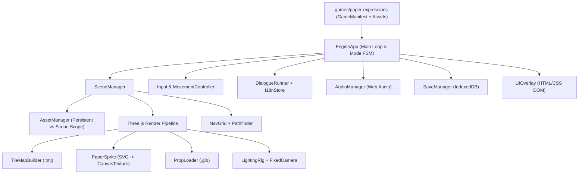
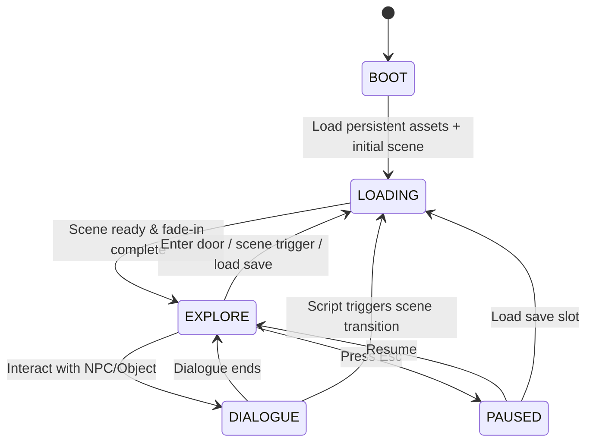

# Stapler Engine — Technical Architecture

Date: 2026-11-20  
Status: Draft v1.0  
Depends on: [1-Stapler_Engine.md](./1-Stapler_Engine.md)

---

## 1. Architectural Principles & Stack

**Core Stack**
* **Language:** TypeScript (strict mode enabled)
* **3D Renderer:** Three.js (WebGL2)
* **Build Tooling:** Vite (workspace monorepo)
* **Unit Testing:** Vitest (`environment: 'node'` — fast, deterministic, zero browser/WebGL flakiness)
* **UI Layer:** Responsive HTML/CSS overlay (zero WebGL UI rendering)
* **Audio:** Web Audio API (`.opus` primary, `.mp3` fallback)
* **Persistence:** IndexedDB (configurable save slots + optional autosave + user settings)
* **Level Authoring:** Tiled Map Editor (`.tmj` JSON export)

**Non-Negotiable Design Rules**
1. **Strict Engine / Game Decoupling:** `packages/stapler-engine` MUST contain zero references to *Paper expressions*, Chloe, Ada, or any game-specific flags/scenes. Games inject content exclusively through a typed `GameManifest` and declarative data files.
2. **Data-Driven Content:** Environments, lighting rigs, props, sprites, dialogues, and translations are loaded from external assets/configs rather than hardcoded in TypeScript classes.
3. **Deterministic GPU & Audio Disposal:** Every resource is owned by `AssetManager` under either `persistent` or `scene` scope. Leaving an environment unconditionally calls `.dispose()` on all `scene`-scoped Three.js geometries, materials, and textures.
4. **Clamped Simulation Step:** The main loop clamps frame delta (`dt <= 0.05s`) so tab-switching or frame drops never teleport characters through tile collisions.
5. **Pure Logic Boundaries for Flakeless Testing:** Parsing, math, collisions, pathfinding, patrols, dialogue execution, and state transitions MUST stay decoupled from `WebGLRenderer`, DOM, `AudioContext`, and real timers—receiving explicit `dt` values and thin I/O adapters so unit tests run purely in Node with zero flakiness.

---

## 2. Repository & Package Layout

```text
stapler-workspace/
├── package.json                       # Workspace root (npm/pnpm workspaces)
├── tsconfig.base.json                 # Shared strict TS config
├── packages/
│   └── stapler-engine/                # Reusable 2.5D narrative framework
│       └── src/
│           ├── index.ts               # Public API exports
│           ├── core/
│           │   ├── EngineApp.ts       # Main loop, mode FSM, subsystem wiring
│           │   ├── EventBus.ts        # Typed pub/sub for cross-module signals
│           │   ├── SceneManager.ts    # Async load/unload/transition lifecycle
│           │   ├── AssetManager.ts    # Scoped cache + Three.js .dispose()
│           │   └── GameState.ts       # Runtime story flags & player state
│           ├── render/
│           │   ├── ViewportManager.ts # Responsive canvas + CSS --ui-scale
│           │   ├── TileMapBuilder.ts  # Tiled .tmj -> merged floor, border & interior walls
│           │   ├── PaperSprite.ts     # Rasterized SVG plane + UV animation + alphaTest shadows
│           │   ├── SvgTextureLoader.ts# SVG -> high-DPI CanvasTexture / atlas
│           │   ├── PropLoader.ts      # .glb loader + prototype cloning
│           │   ├── LightingRig.ts     # Configurable lights (max 2 shadow casters) + flat mode
│           │   ├── FixedCamera.ts     # Fixed angle, damped follow, camera light
│           │   └── DebugOverlay.ts    # Optional toggleable NavGrid, collider, trigger & patrol lines
│           ├── navigation/
│           │   ├── NavGrid.ts         # Compact Uint8Array grid + sub-tile 2D AABB/circle colliders
│           │   ├── Pathfinder.ts      # 8-way A* + radius-aware line-of-sight string-pulling
│           │   ├── MovementController.ts # Float click-to-move + WASD collision slide
│           │   ├── InteractionSystem.ts  # Walk-over zones, raycast clicks, Spacebar query & cues
│           │   └── NpcController.ts      # Idle animations + Tiled waypoint patrol paths
│           ├── dialogue/
│           │   ├── ScriptParser.ts    # Lightweight .dlg script parser
│           │   ├── DialogueRunner.ts  # State machine executing dialogue AST
│           │   └── I18nStore.ts       # Locale JSON loader & key resolver
│           ├── audio/
│           │   └── AudioManager.ts    # Web Audio graph (BGM / SFX queue / Voice)
│           ├── persistence/
│           │   └── SaveManager.ts     # IndexedDB configurable save slots + user settings
│           ├── ui/
│           │   ├── UIOverlay.ts       # Root DOM overlay manager
│           │   ├── DialogueView.ts    # Portraits (L/C/R) + typewriter textbox
│           │   ├── PauseMenuView.ts   # Resume, Settings (Lang/Audio), Save/Load
│           │   └── LoadingView.ts     # Animated scene-transition overlay
│           └── types/
│               └── contracts.ts       # Shared public TypeScript interfaces
└── games/
    └── paper-expressions/             # Vertical-slice test game
        ├── index.html
        ├── src/
        │   ├── main.ts                # Bootstraps EngineApp with GameManifest
        │   └── manifest.ts            # Environments, characters, audio, locales
        └── public/assets/
            ├── maps/                  # Tiled .tmj files (6 environments)
            ├── tilesets/              # Floor & wall texture atlases
            ├── sprites/               # Character/object SVGs + animation JSON
            ├── models/                # .glb 3D environment props
            ├── scripts/               # .dlg conversation & event scripts
            ├── locales/               # en.json, es.json, ...
            └── audio/                 # .opus + .mp3 BGM & SFX
```

### High-Level System Diagram



---

## 3. Core Lifecycle & Mode State Machine

The engine runs a strict finite state machine (`EngineMode`) to prevent overlapping inputs or race conditions between gameplay, menus, and scene loads:



### Input Routing by Mode
| Mode | Pointer / Click | WASD / Arrows | Space / Enter | Escape |
| :--- | :--- | :--- | :--- | :--- |
| `EXPLORE` | Move to floor tile or walk-and-interact with clicked target | Smooth float movement + collision slide | Interact with nearest target within its radius (default `1.25` tiles) | Open Pause Menu |
| `DIALOGUE` | Complete typewriter line / advance | Ignored | Complete typewriter line / advance | Ignored (or optional skip) |
| `PAUSED` | DOM Menu clicks only | Menu navigation | Confirm | Resume (`EXPLORE`) |
| `LOADING` | Blocked | Blocked | Blocked | Blocked |

### Environment Transition Sequence
1. Switch mode to `LOADING`; fade in HTML `LoadingView` animation.
2. Cancel active pathfinding and suspend world updates.
3. Call `SceneManager.unloadCurrent()` → removes scene objects from `THREE.Scene` and invokes `AssetManager.disposeScope('scene')` (freeing geometries, materials, textures, and scene-only SFX buffers).
4. Fetch target `.tmj` map and its referenced scene assets (`tilesets`, `.glb` props, NPC SVGs, BGM).
5. Build `NavGrid`, merged floor/wall `BufferGeometry`, `LightingRig`, `FixedCamera`, props, and NPCs.
6. Position persistent player entity at requested `spawnId` (or loaded save coordinates) and crossfade BGM if track changed.
7. Render one warm-up frame to compile shaders, hide `LoadingView`, and switch mode to `EXPLORE`.

---

## 4. Subsystem Specifications & Core Interfaces

### 4.1 Coordinate System & Viewport (`render/ViewportManager.ts`)
* **World Units:** `1.0` Three.js unit = `1` tile.
* **Axes:** `+X` right, `+Y` up, `+Z` toward the camera. Tile `(col, row)` spans `[col, col + 1]` on X and `[row, row + 1]` on Z, with center `(col + 0.5, 0, row + 0.5)`.
* **Responsiveness:** A `ResizeObserver` watches the game mount element. On resize:
  * Updates `WebGLRenderer.setSize(width, height, false)` with `Math.min(window.devicePixelRatio, 2)`.
  * Updates `PerspectiveCamera.aspect` and projection matrix.
  * Computes a normalized CSS variable (`--ui-scale`) so the HTML/CSS dialogue box, portraits, and pause menu scale cleanly across 16:9, 16:10, 4:3, and narrow panes without clipping.

### 4.2 Tile Environments (`render/TileMapBuilder.ts`)
* **Configurable Tile Budget:** Supports arbitrary rectangular maps within configurable guardrails (`maxTiles = 4096`, `maxDimension = 64` by default via `EngineConfig`), allowing both compact square rooms (`12×12`) and long corridors/streets (`48×10`).
* **Merged Geometry & Non-Rectangular Rooms:** Iterates over the `floor` tile layer and writes tile quads directly into one `BufferGeometry` per tileset atlas using UV coordinates derived from tile GIDs (typically **1 draw call** for the entire floor). Any empty floor tile (`GID = 0`) emits **no floor quad** and is automatically marked `BLOCKED` in `NavGrid`, enabling L-shaped rooms, alcoves, and indented layouts inside a rectangular grid cheaply.
* **Border & Interior Walls:**
  * Generates flat vertical quad strips along north, south, east, and west map boundaries of any height `>= 0` (UV tiled vertically; `0` or `transparent: true` omits the visual mesh while keeping boundary collision).
  * Supports an optional Tiled `interior_walls` object layer containing rectangle or polyline wall segments (`height`, `textureId`, `doubleSided`, `castShadow`). Segments are extruded into vertical quads/thin boxes, merged into the wall mesh, and automatically registered as solid 2D AABB obstacles in `NavGrid`. This allows framing interior partitions or closed-off rooms whose doors transition into separate smaller environments.
  * *Camera occlusion rule:* Keep south-facing interior partitions low or omitted so the fixed camera never loses sight of the player behind a tall wall.

### 4.3 2D SVG Paper-Cutout Sprites (`render/PaperSprite.ts` & `SvgTextureLoader.ts`)
* **SVG Rasterization Pipeline:**
  1. Fetch `.svg` (or pre-packed SVG sprite sheet).
  2. Render onto an `OffscreenCanvas` / `<canvas>` at `renderWidth × renderHeight` (e.g., 2×–4× DPR capped at 2048px atlas dimension) and wrap in `THREE.CanvasTexture` (`colorSpace = THREE.SRGBColorSpace`).
  3. Cache texture in `AssetManager` (player sprites stay in `persistent` scope; room-specific NPCs live in `scene` scope).
* **Material & Alpha-Cutout Shadows:**
  * Uses `THREE.MeshStandardMaterial` with `alphaTest: 0.5`, `transparent: false`, `side: THREE.DoubleSide`, `roughness: 0.85`, `metalness: 0.0`.
  * Setting `transparent: false` + `alphaTest` eliminates 2.5D depth-sorting bugs between overlapping sprites and enables clean shadow casting.
  * For animated UV sprite sheets (`columns × rows`), `PaperSprite` attaches a `customDepthMaterial` (`THREE.MeshDepthMaterial` with `depthPacking: THREE.RGBADepthPacking`, sharing the same `map` and `alphaTest`) and synchronizes `map.offset` / `map.repeat` on frame change so cast shadows always match the exact silhouette of the active animation frame (idle, front/back walk cycles, emotion poses).
* **Paper Flip Animation:** When facing reverses horizontally (`left` ↔ `right`), runs a 140 ms eased tween rotating `mesh.rotation.y` from `0` to `π` (or flipping UV/scale across `0`) to achieve a tactile *Paper Mario*-style card turn.

```ts
export interface SpriteAnimationClip {
  row: number;
  frames: number;
  fps: number;
  loop: boolean;
}

export interface SpriteAnimationSpec {
  id: string;
  svgUrl: string;
  renderWidth: number;
  renderHeight: number;
  worldHeight: number;          // Height in tile units (e.g. 1.6 - 2.1)
  columns?: number;             // Defaults to 1 (single static frame)
  rows?: number;                // Defaults to 1
  animations?: Record<string, SpriteAnimationClip>;
}
```

### 4.4 Lighting Rig & Fixed Camera (`render/LightingRig.ts`, `FixedCamera.ts`)
* **Budget Enforcement:**
  * Soft configurable light budget per environment (default `maxLights = 8`; configurable via `EngineConfig`).
  * Hard guardrail of **maximum 2 shadow-casting lights** (`castShadow = true`); shadow maps default to `1024×1024` `PCFSoftShadowMap` with tuned `shadow.bias` (`-0.0005`) and `shadow.normalBias` (`0.02`) to prevent shadow acne on thin 2D planes.
  * `setDynamicLighting(enabled: boolean)`: When `false`, disables dynamic scene lights and enables a uniform `AmbientLight` (`intensity: 1.0`) so every sprite and tile receives flat, even lighting.
* **Camera Modes:**
  * Fixed pitch/angle and base offset per environment.
  * Optional `followPlayer: boolean` with exponential damping (`1 - Math.exp(-speed * dt)`) clamped within optional room camera bounds so edges outside the walls stay hidden.
  * Optional `cameraLight`: a spotlight/directional light parented to the camera (counted inside the light budget).

### 4.5 3D Props (`render/PropLoader.ts`)
* Uses `GLTFLoader` exclusively for **`.glb`** assets (with optional `DRACOLoader` hook).
* Base scenes are cached in `AssetManager` and instantiated via `.clone(true)`, applying `castShadow` and `receiveShadow` per prop metadata.

### 4.6 Navigation, Collisions, Triggers & NPCs (`navigation/`)
* **`NavGrid` & Hybrid Colliders:**
  * Stores a `Uint8Array(width * height)` (`<= 4,096` bytes under default budget) with `WALKABLE` / `BLOCKED` bits populated from Tiled's `collision` layer **and** empty void tiles (`GID = 0`) on the `floor` layer.
  * Supplements the tile grid with lightweight **2D AABB obstacle boxes** (auto-generated from `interior_walls` and `.glb` prop footprints) and **circular NPC blockers** (`radius ≈ 0.3` tiles) so thin walls, furniture, and standing NPCs collide cleanly without requiring a 3D physics engine.
* **Point-and-Click (`Pathfinder`):**
  1. Raycast pointer against interactable hitboxes first, then against the floor plane (`y = 0`).
  2. Run 8-directional A* using a binary min-heap (diagonal moves disallowed if either adjacent cardinal tile is blocked — prevents clipping corners).
  3. Run **radius-aware line-of-sight string-pulling** (supercover/parallel-ray grid & AABB check inflated by the player's `0.28` radius) across the A* node list so float movement stays smooth without snagging on blocked corners.
  4. If an interactable was clicked, target the nearest walkable tile within that target's `interactionRadius` (default `1.25` tiles, configurable per object/NPC) and queue its interaction callback upon arrival.
* **Keyboard Movement (`MovementController`):**
  * Pressing WASD/Arrows immediately cancels any active click-to-move path.
  * Resolves X and Z axes independently against `NavGrid`, 2D AABB obstacles, and circular NPC blockers using a player collider (`radius = 0.28` tiles) so the player slides smoothly along walls and furniture instead of snagging.
  * Pressing `Spacebar` queries all active `Interactable` entities within their respective `interactionRadius` (default `1.25` tiles), picking the closest one (with a small dot-product bias toward the player's facing direction).
* **Scene Transitions, Triggers & Visual Cues (`InteractionSystem`):**
  * Supports two trigger modes authored in Tiled's `objects` layer:
    * **Walk-over zone (`triggerMode: 'enter'`):** A rectangle (e.g., street exit, staircase landing) that fires automatically when the player enters its bounds. Supports `oneShot` and optional flag guards; return `spawn` markers should be placed outside the zone to prevent instant re-triggering.
    * **Interactable trigger (`triggerMode: 'interact'`):** Doors, props, and NPCs triggered by click-to-walk or `Spacebar` within `interactionRadius`.
  * Each trigger carries `{ targetEnv?, targetSpawnId?, facing?, scriptId?, oneShot? }`. Conditional doors (e.g., locked doors or story cutscenes) can invoke a `.dlg` `scriptId` that runs `@transition` when conditions pass.
  * Provides **visual interaction cues**: pointer cursor changes on hovering a raycastable interactable, and a subtle proximity indicator/prompt appears when an interactable target is within `Spacebar` range.
* **NPC Idle & Patrol Controller (`NpcController`):**
  * Drives per-NPC animation states (`idle`, `walk_front`, `walk_back`) and optional designated patrol routes referencing a Tiled `patrol` polyline/polygon object (`patrolPath`).
  * Supports `patrolMode: 'loop' | 'pingpong' | 'once'`, configurable `moveSpeed`, and `waitAtWaypointSec` pauses at each point.
  * Automatically halts movement and turns to face the player during interaction, freezes while `EngineMode !== 'EXPLORE'`, and pauses briefly if the player steps directly into its path.

### 4.7 Dialogue Script Format & Localization (`dialogue/`)
Conversations use a compact, human-readable `.dlg` format that stores **flow, stage directions, scene transitions, and string keys** — never hardcoded prose:

```text
# scripts/campus_ada_lunch.dlg
@sfx ui_dialog_open
@portrait left chloe sleepy
@portrait right ada inquiry

say ada campus_ada_01
say chloe campus_chloe_01

@portrait right ada surprise
@sfx gasp_light
say ada campus_ada_02

@if fell_downstairs == true
  @portrait left chloe nervous
  say chloe campus_chloe_secret_01
@else
  say chloe campus_chloe_normal_01
@endif

@set invited_to_lunch true
# Optional scene warp from dialogue (e.g. entering class or post-cutscene):
# @transition classroom spawn_door
@end
```

Supported directives: `@portrait <left|center|right> <character> <pose> [left|right]`, `@box <styleName>` (sets `data-box-style` on the dialogue box so games can theme variants like `default`, `thought`, or `system` via CSS alongside `GameManifest.uiTheme`), `@sfx <id>`, `@voice <id>`, `say <speaker> <lineKey>`, `append <speaker> <lineKey>` (appends onto the active box without clearing previous text, useful for mid-sentence portrait/SFX swaps), `@if <flag> == <value>` / `@else` / `@endif`, `@set <flag> <value>`, `@transition <envId> <spawnId> [facing]`, `@wait <seconds>`, and `@end`. Localized strings also support inline pacing tags `{p}` (click-to-continue mid-sentence) and `{w=0.4}` (timed beat).

Localized strings live in `public/assets/locales/<lang>.json`:
```json
{
  "speakers": {
    "chloe": "Chloe",
    "ada": "Ada"
  },
  "lines": {
    "campus_ada_01": "Hey Chloe! Want to grab lunch before class?",
    "campus_chloe_01": "...I am currently operating full"
  }
}
```
* `I18nStore` resolves keys dynamically from the active language (falling back to the default locale if a key is missing), so switching language in the Pause Menu updates UI and dialogue immediately with zero script duplication.

### 4.8 Audio System (`audio/AudioManager.ts`)
* **Web Audio Graph:**
  ```text
  BgmSource   ──▶ BgmGain   ──┐
  SfxPool[N]  ──▶ SfxGain   ──┼──▶ MasterGain ──▶ AudioContext.destination
  VoiceSource ──▶ VoiceGain ──┘
  ```
* **Format Selection:** At boot, probes browser support for `audio/ogg; codecs=opus` / `audio/webm; codecs=opus`; selects `.opus` when supported and falls back to `.mp3`.
* **Autoplay Unlock:** Attaches a one-shot `pointerdown` / `keydown` listener calling `audioCtx.resume()` and flushes any queued initial BGM track.
* **SFX Concurrency Limit:** Configurable `maxConcurrentSfx` (default `8`). When the active SFX pool is full, new SFX either wait in a short bounded queue (`maxQueueSize`, dropping stale triggers after 150 ms) or steal the oldest playing instance depending on priority.
* **Voice Channel:** Single-slot channel (`playVoice(id)` automatically stops the prior voice clip when advancing dialogue).

### 4.9 Persistence & Memory Lifecycle (`persistence/SaveManager.ts`, `core/AssetManager.ts`)
* **IndexedDB Database:** `stapler_db_<gameId>` (version 1) with two object stores:
  * `saves`: Keys `"slot_1"` through `"slot_<maxSaveSlots>"` (default `10`) plus optional `"autosave"` (`save`, `load`, `erase`, `list`).
  * `settings`: Singleton key `"user_settings"` (`language`, `bgmVolume`, `sfxVolume`, `voiceVolume`, `bgmMuted`, `sfxMuted`).

```ts
export interface SaveSlotData {
  schemaVersion: 1;
  slotId: number | 'autosave';
  savedAt: string;              // ISO-8601 timestamp
  environmentId: string;
  environmentTitleKey: string;  // Localized room name for Save/Load UI
  player: {
    x: number;
    z: number;
    facing: 'front' | 'back' | 'left' | 'right';
  };
  flags: Record<string, boolean | number | string>;
  playtimeSeconds: number;
}
```

* **`AssetManager` Disposal Contract:**
  * Every texture, geometry, material, and GLB root created during a scene load registers under `scope = 'scene'`.
  * `disposeScope('scene')` iterates all registered entries, calls `.dispose()` on Three.js GPU objects (including sub-mesh geometries, materials, and texture maps inside loaded `.glb` hierarchies), and clears the map before loading the next environment.

---

## 5. Tiled (`.tmj`) Authoring Contract

Every environment is authored visually in **Tiled** using four standardized layers:

| Tiled Layer | Type | Purpose |
| :--- | :--- | :--- |
| `floor` | Tile Layer | Floor tile GIDs mapped to a tileset texture atlas; empty tiles (`GID = 0`) emit no floor quad and are automatically marked `BLOCKED` in `NavGrid` |
| `collision` | Tile Layer | Any non-zero tile marks that cell `BLOCKED` in `NavGrid` |
| `walls` | Map Properties + Optional `interior_walls` Object Layer | Custom properties `wallNorth`, `wallSouth`, `wallEast`, `wallWest` (`>= 0` tiles tall; `0` = transparent/omitted) + `wallTextureId`; optional `interior_walls` object layer of rect/polyline segments (`height`, `textureId`, `doubleSided`, `castShadow`) generating wall geometry + 2D AABB collision |
| `objects` | Object Layer | Markers/shapes with `type` in `spawn`, `npc`, `prop_glb`, `sprite_2d`, `trigger`, `light`, `patrol`: `trigger` supports `triggerMode` (`enter` \| `interact`), `targetEnv`, `targetSpawnId`, `facing`, `scriptId`, `oneShot`, `interactionRadius`; `npc` supports `spriteId`, `scriptId`, `interactionRadius`, `patrolPath`, `patrolMode` (`loop` \| `pingpong` \| `once`), `moveSpeed`, `waitAtWaypointSec` |

### Environment & Manifest Contracts (`types/contracts.ts`)

```ts
export interface LightConfig {
  type: 'directional' | 'point' | 'spot' | 'hemisphere';
  color: string;
  intensity: number;
  position?: [number, number, number];
  castShadow?: boolean;         // Engine enforces max 2 per scene
  attachToCamera?: boolean;     // Optional camera-mounted light
}

export interface EnvironmentConfig {
  id: string;
  titleKey: string;             // i18n key
  mapUrl: string;               // Path to Tiled .tmj
  bgmId?: string;
  dynamicLighting: boolean;     // false => uniform flat ambient lighting
  lights: LightConfig[];        // Engine enforces <= maxLights (default 8) & <= 2 shadow casters
  camera: {
    fov: number;
    offset: [number, number, number];
    lookAtOffset: [number, number, number];
    followPlayer: boolean;
    bounds?: { minX: number; maxX: number; minZ: number; maxZ: number };
  };
}

export interface GameManifest {
  gameId: string;
  defaultLocale: string;
  supportedLocales: string[];
  initialEnvironmentId: string;
  initialSpawnId: string;
  playerSpriteId: string;
  maxConcurrentSfx: number;
  maxSaveSlots?: number;        // Default 10
  enableAutosave?: boolean;     // Default true
  defaultInteractionRadius?: number; // Default 1.25 tiles
  environments: Record<string, EnvironmentConfig>;
  sprites: Record<string, SpriteAnimationSpec>;
  audio: Record<string, { opus: string; mp3: string; kind: 'bgm' | 'sfx' | 'voice' }>;
}
```

---

## 6. Automated Unit Testing Strategy

Stapler Engine uses a **lightweight, critical-path testing strategy** designed to catch subtle engine and content bugs in under a second without introducing browser flakiness or heavy mocking overhead.

### Runner, Layout & Zero-Flake Rules
* **Runner:** **Vitest** (`environment: 'node'`), reusing Vite's TypeScript and `"moduleResolution": "Bundler"` resolver with a single devDependency and zero extra build step.
* **Co-located tests:** Test files live beside their target module as `*.test.ts` (excluded from production Vite bundles) and run via root `npm test` (`vitest run`), `npm run test:watch` (`vitest`), and inside `setup.sh` after `npm run typecheck`.
* **No DOM / WebGL / wall-clock timers:**
  * Most Three.js math and scene-graph primitives (`Group`, `Mesh`, `PlaneGeometry`, `MeshStandardMaterial`, `DirectionalLight`, `PerspectiveCamera`, `Vector3`) instantiate cleanly in pure Node without `jsdom` or a WebGL context.
  * Time-dependent modules (`PaperSprite`, `FixedCamera`, `NpcController`, `MovementController`) are always stepped with explicit `dt` arguments—never `setTimeout`, `Date.now()`, or `requestAnimationFrame`.
  * I/O boundaries stay thin: `.tmj` and `.dlg` parsers accept plain objects/strings, and `SaveManager` accepts a minimal storage adapter interface (real `IndexedDB` in browser, in-memory `Map` in tests).
* **Explicitly skipped in unit tests (verified visually in `npm run dev`):** `ViewportManager` (`WebGLRenderer`/`ResizeObserver`), `SvgTextureLoader` (`Image`/`<canvas>` rasterization), `PropLoader` network fetches, HTML/CSS `UIOverlay` layout, `DebugOverlay` visuals, and Web Audio hardware playback.

### Critical-Path Coverage Matrix by Milestone
| Milestone | High-ROI Unit Tests |
| :--- | :--- |
| **Milestone 1 (Foundation)** | `AssetManager` (scoped `.dispose()` freeing `scene` resources without touching `persistent` textures shared by scene materials), `LightingRig` (`maxLights` & `maxShadowLights` caps, flat/dynamic toggle, shadow map disposal), `FixedCamera` (bounds clamping, follow fallback, damped convergence), `PaperSprite` (`alphaTest`/`transparent: false` invariants, deterministic 140 ms flip rotation). |
| **Milestone 2 (World & Nav)** | `NavGrid` & hybrid colliders (void `GID = 0` blocking, 2D AABB `interior_walls`/props, NPC circle blockers, separate X/Z wall sliding), `Pathfinder` (8-way A*, no diagonal corner-cutting, unreachable goals, radius-aware string-pulling), `.tmj` parser & tile-budget validation, `InteractionSystem` (`enter` zone + `oneShot` guard, `Spacebar` nearest-in-radius selection), `NpcController` (`loop`/`pingpong`/`once` patrols & auto-pause), `PaperSprite` multi-frame UV animation sync. |
| **Milestone 3 (Narrative & State)** | `ScriptParser` & `DialogueRunner` (`.dlg` AST, `@if`/`@else`/`@set`, `@transition`, syntax errors), `I18nStore` (locale switching & fallback to `defaultLocale`), `EngineApp` mode FSM & `GameState` (valid transitions, input gating, `dt <= 0.05` clamp), `SaveManager` (`SaveSlotData` v1 serialization & slot bounds over an in-memory adapter). |
| **Milestone 4 (Game Content)** | **Content Integrity Test** in `games/paper-expressions`: scans real `.tmj`, `.dlg`, `locales/*.json`, and `manifest.ts` files on disk to verify every dialogue key exists in every supported locale, every `@transition` targets a valid environment + `spawnId`, every `npc.patrolPath` matches a polyline in its map, and all maps fit tile & shadow budgets. |

---

## 7. Mapping *Paper expressions* to Stapler Engine

All 6 prologue environments run cleanly on the engine without any game-specific code inside `stapler-engine`:

| Scene ID | Shared Assets / Reuse | Key Engine Features Exercised |
| :--- | :--- | :--- |
| `apt_interior` | Interior floor/wall atlas, `.glb` desk & bed | Start state, object inspection, door trigger, first save |
| `apt_hallway_high` | Tower hallway tileset (shared) | Fixed hallway camera with horizontal follow, stairs trigger (`fell_downstairs = true`) |
| `apt_hallway_low` | Reuses tower hallway tileset with different doors/NPCs | Verifies scene disposal + tileset reuse + post-fall cable/android reveal dialogue |
| `front_road` | Exterior street atlas, `.glb` streetlamp & bench | Directional sun shadow caster + camera follow along wider horizontal strip |
| `campus` | Outdoor campus atlas, paper-cutout trees | Multi-NPC interactions (Ada lunch invite, portraits + emotion swaps, localization) |
| `classroom` | Classroom atlas, `.glb` desks & chalkboard | Turrialba dialogue, day-cycle flag update (`day_phase = 'evening'`), return trip to `apt_interior` (Professor reveal) |

---

## 8. Implementation Milestones (Build Order)

1. **Milestone 1 — Workspace, Rendering Tech Spike & Test Harness**
   * Scaffold Vite + TypeScript monorepo (`packages/stapler-engine` + `games/paper-expressions`). *(Completed)*
   * Build `ViewportManager`, `SvgTextureLoader`, `PaperSprite` (with `alphaTest` + `customDepthMaterial` silhouette shadows), `LightingRig`, and `FixedCamera`. *(Completed)*
   * Verify 1 greybox room with Unua standing on lit tiles casting crisp cutout shadows at 60 FPS. *(Completed)*
   * Configure **Vitest** (`environment: 'node'`, `npm test`, `setup.sh` check) and add foundation unit tests for `AssetManager`, `LightingRig`, `FixedCamera`, and `PaperSprite`. *(Completed)*
2. **Milestone 2 — Tiled Loader, Sprite Animation, Collisions, Patrols & Props *(Completed)***
   * Implement `TileMapBuilder` (`.tmj` floor with void/non-rectangular support + border walls + `interior_walls` segments). *(Completed)*
   * Extend `PaperSprite` with multi-frame UV sprite-sheet animations (idle, front/back walk cycles) synced to `customDepthMaterial`. *(Completed)*
   * Implement `PropLoader` (`.glb`), `NavGrid` (tiles + sub-tile 2D AABB + NPC circle colliders), `Pathfinder` (8-way A* + radius-aware string-pulling), `MovementController` (click + WASD slide), `InteractionSystem` (`enter` walk-over zones + `interact` click/`Spacebar` + hover/proximity cues), `NpcController` (idle + Tiled waypoint patrol paths), and a toggleable `DebugOverlay` for inspecting nav grids, colliders, triggers, and patrol routes. *(Completed)*
   * Add unit tests for `.tmj` parsing/budgets, `NavGrid`/AABB/NPC collision sliding, `Pathfinder` A* + string-pulling, `InteractionSystem` triggers, `NpcController` patrols, and `PaperSprite` UV clips. *(Completed)*
3. **Milestone 3 — Narrative, Audio & Persistence *(Completed)***
   * Implement `EngineApp`, `EventBus`, `ModeFsm`, `SceneManager`, and `GameState`. *(Completed)*
   * Implement `ScriptParser` (`.dlg` including `@if`/`@else`, `@set`, `@transition`, `@wait`), `DialogueRunner`, `I18nStore`, and HTML/CSS `UIOverlay` (`DialogueView`, `PauseMenuView`, `LoadingView`). *(Completed)*
   * Implement `AudioManager` (`.opus`/`.mp3`, concurrency limit, autoplay unlock), `AssetManager` (`.dispose()` verification across transitions), and `SaveManager` (IndexedDB configurable save slots, default 10 + optional autosave, plus user settings). *(Completed)*
   * Add unit tests for `ScriptParser`/`DialogueRunner`, `I18nStore`, `ModeFsm`/`GameState` + `dt` clamping, `SfxConcurrencyLimiter`, and `SaveManager` (via an in-memory storage adapter). *(Completed)*
4. **Milestone 4 — *Paper expressions* Vertical Slice**
   * Author all 6 Tiled `.tmj` maps, plug in finalized SVGs / `.glb` props / `.dlg` scripts / localized JSONs / audio, add the automated content-integrity test, and playtest the full 15-minute day cycle + save/load across all rooms.
